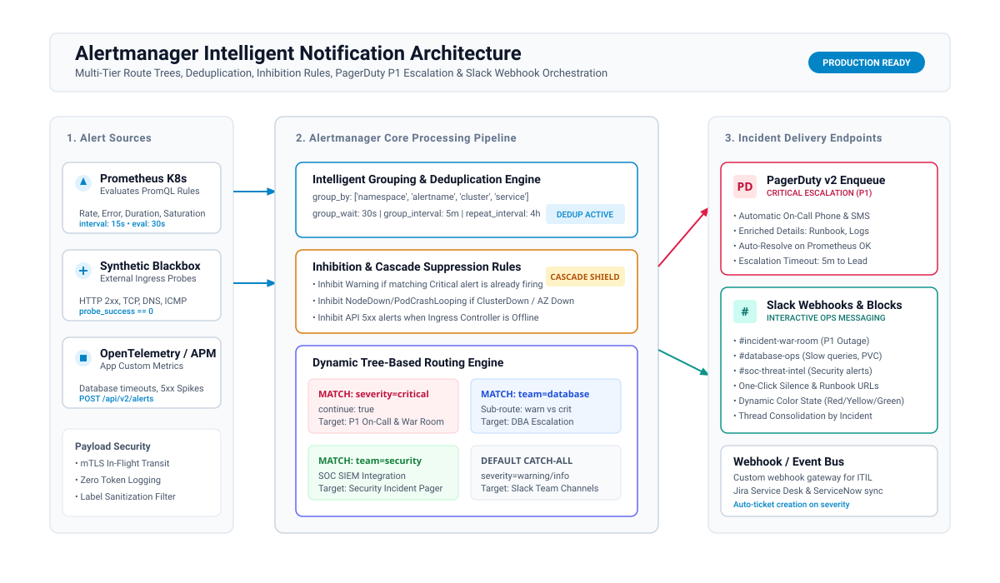

# Alertmanager Intelligent Incident Routing Engine

<div align="center">

[]()
[]()
[](LICENSE)
[](SECURITY.md)

</div>

---

## 📌 Executive Summary

**Alertmanager PagerDuty & Slack Routing** is an enterprise-grade incident management and telemetry routing framework engineered to eliminate alert fatigue, suppress cascading notification storms, and automate high-fidelity on-call escalation across mission-critical multi-cluster Kubernetes environments.

Operating as the central dispatch brain downstream of Prometheus and synthetic probing systems, this implementation provides deterministic route trees, contextual grouping, multi-tier inhibition policies, and template-driven interactive notification blocks for Slack and PagerDuty.

### Key Operational Outcomes
- **Cascade Suppression:** Eliminates secondary alarm storms (e.g. inhibiting thousands of Pod network errors during a node isolation or datacenter link failure).
- **Sub-Second On-Call Dispatch:** Critical P1 alerts bypass standard aggregation buffers and dispatch directly to PagerDuty via the Events API v2 with automatic telephony/SMS escalation.
- **Actionable ChatOps:** Enriches Slack notifications with live Grafana dashboard deep links, runbooks, and one-click silence triggers.
- **Zero-Trust Security:** Secret parameters and routing tokens isolated via environment substitution; no plaintext credentials committed to version control.

---

## 🏗️ System Architecture

The following vector blueprint details the end-to-end telemetry lifecycle from metrics evaluation to multi-channel incident dispatch:

<div align="center">
  
</div>

---

## ✨ Enterprise Capabilities

| Capability | Engineering Mechanism | Production Benefit |
| :--- | :--- | :--- |
| **Intelligent Deduplication** | `group_by: [namespace, alertname, cluster, service]` | Consolidates identical pod failures into a single incident card. |
| **Cascade Inhibition** | Cross-label matching (`equal: [cluster, service]`) | Suppresses warning noise when critical parent outages are active. |
| **P1 Escalation Routing** | Route tree with `continue: true` | Simultaneously notifies on-call via PagerDuty and fires the Slack War Room. |
| **Domain-Specific Isolation**| Tag-based routing (`team: database`, `team: security`) | Directs DBA issues to Database SREs and security anomalies to the SOC. |
| **Dynamic Templating** | Go `text/template` formatting engine | Provides uniform incident cards with color-coded severity and timestamps. |

---

## 📂 Repository Layout

```text
.
├── alertmanager.yml             # Production Alertmanager configuration with route trees & receivers
├── inhibit_rules.yml            # Enterprise cascade suppression rules catalog
├── docker-compose.yml           # Complete containerized local sandbox runtime
├── Makefile                     # Standardized developer automation targets
├── SECURITY.md                  # Responsible disclosure policy and security controls
├── .gitattributes               # Cross-platform line-ending & GitHub Linguist overrides
├── config/
│   └── production.env.example   # Environment template for webhook secrets
├── docs/
│   └── architecture.svg         # Pure white theme architectural vector diagram
├── scripts/
│   └── healthcheck.sh           # SRE synthetic healthcheck verification script
├── templates/
│   └── default.tmpl             # Go templates for rich Slack & PagerDuty notification blocks
└── tests/
    └── test_validation.py       # Automated configuration and YAML integrity test suite
```

---

## ⚡ Quick Start & Verification

### Prerequisites
- Docker Engine `>= 24.0` & Docker Compose v2
- Python `>= 3.9` (for configuration unit tests)
- `curl` or `wget`

### 1. Configure Secrets
Copy the environment template and provide test credentials:
```bash
cp config/production.env.example .env
```

### 2. Validate Configurations
Execute the test suite to ensure YAML parsing, schema conformance, and file integrity:
```bash
python3 -m unittest discover -s tests -p "test_*.py"
```

### 3. Launch Local Runtime
Start the Alertmanager container service:
```bash
docker compose up -d
```

### 4. Verify Health Status
Execute the health check probe:
```bash
bash scripts/healthcheck.sh
```

### 5. Send a Mock Critical Alert
Simulate an active Prometheus alert to test routing:
```bash
curl -XPOST -H "Content-Type: application/json" -d '[
  {
    "labels": {
      "alertname": "DatabaseDeadlockSpike",
      "severity": "critical",
      "cluster": "prod-us-east-1",
      "namespace": "storage",
      "service": "postgres-cluster",
      "team": "database"
    },
    "annotations": {
      "summary": "Database connection deadlocks exceeding threshold (>50/sec)",
      "description": "High contention on account_balances table causing transaction rollbacks.",
      "runbook_url": "https://wiki.internal/runbooks/db-deadlocks"
    }
  }
]' "http://localhost:9093/api/v2/alerts"
```

---

## ⚙️ Configuration Reference

### Routing Trees
```yaml
route:
  group_by: ['namespace', 'alertname', 'cluster', 'service']
  group_wait: 30s
  group_interval: 5m
  repeat_interval: 4h
  receiver: 'slack-default'
  routes:
    - match:
        severity: critical
      receiver: 'pagerduty-high-priority'
      continue: true
    - match:
        severity: critical
      receiver: 'slack-critical-warroom'
```

### Inhibition Rules
```yaml
inhibit_rules:
  - source_match:
      severity: 'critical'
    target_match:
      severity: 'warning'
    equal: ['alertname', 'cluster', 'service']
```

---

## 🛡️ Security & Operational Hardening

- **Credential Isolation:** Never hardcode webhooks or PagerDuty keys into config files. Use environment variables `${ALERTMANAGER_SLACK_WEBHOOK_URL}` and `${PAGERDUTY_ROUTING_KEY_*}`.
- **Container Isolation:** The Alertmanager container runs with a non-root user (`nobody:nobody`, UID 65534) and read-only filesystem where possible.
- **TLS & mTLS Verification:** Production ingress enforces TLS 1.3 with validated certificates; `insecure_skip_verify` is set to `false`.

---

## 📜 License

Distributed under the MIT License. See [LICENSE](LICENSE) for more details.
